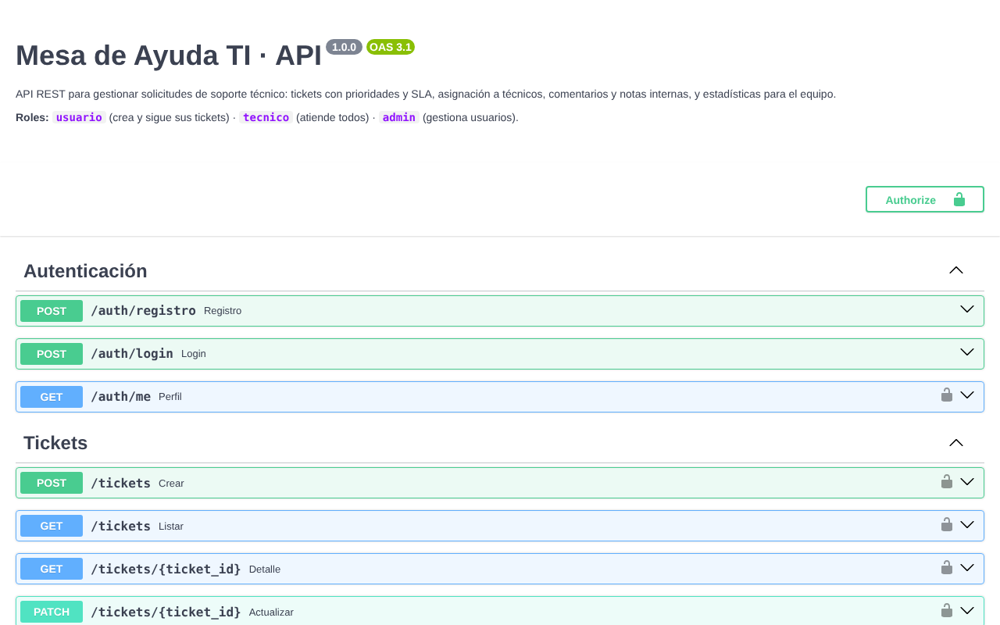

# Mesa de Ayuda TI · API

API REST para gestionar solicitudes de soporte técnico dentro de una organización. Los funcionarios reportan problemas (impresoras, cuentas, red, software), el equipo técnico los atiende según prioridad y plazo, y la jefatura ve indicadores en tiempo real.



## Funcionalidades

- **Autenticación con JWT** y contraseñas cifradas con bcrypt.
- **Roles y permisos:** `usuario` crea y sigue sus tickets · `tecnico` atiende todos · `admin` además gestiona usuarios y elimina tickets.
- **Tickets con SLA:** cada prioridad tiene un plazo máximo (crítica 4 h, alta 24 h, media 72 h, baja 120 h) y la API marca los vencidos.
- **Flujo de estados:** abierto → en progreso → resuelto → cerrado. Al asignar un técnico, el ticket pasa solo a "en progreso".
- **Comentarios y notas internas** que solo ve el equipo técnico.
- **Búsqueda, filtros y paginación** por estado, prioridad, categoría y texto.
- **Estadísticas:** tickets por estado, prioridad y categoría, vencidos y tiempo promedio de resolución.
- **14 tests automatizados** con pytest.

## Tecnologías

Python 3.12 · FastAPI · SQLAlchemy 2.0 · PostgreSQL · Pydantic · JWT · pytest · Docker

## Cómo ejecutarlo

### Opción 1: Docker (recomendada)

```bash
docker compose up --build
docker compose exec api python -m app.seed   # datos de ejemplo
```

La API queda en http://localhost:8000 y la documentación interactiva en http://localhost:8000/docs.

### Opción 2: local

```bash
python -m venv .venv && source .venv/bin/activate   # en Windows: .venv\Scripts\activate
pip install -r requirements.txt
cp .env.example .env        # ajusta DATABASE_URL a tu PostgreSQL
python -m app.seed
uvicorn app.main:app --reload
```

### Usuarios de ejemplo

| Rol      | Email            | Contraseña    |
|----------|------------------|---------------|
| admin    | admin@mesa.cl    | password123   |
| técnico  | tecnico@mesa.cl  | password123   |
| usuario  | usuario@mesa.cl  | password123   |

En `/docs`, presiona **Authorize** e ingresa el email y la contraseña para probar los endpoints.

## Tests

```bash
pytest -q
```

Los tests usan una base SQLite temporal, así que no necesitan PostgreSQL.

## Endpoints principales

| Método | Ruta | Descripción |
|--------|------|-------------|
| POST | `/auth/registro` | Crear cuenta |
| POST | `/auth/login` | Obtener token JWT |
| GET | `/auth/me` | Perfil del usuario actual |
| POST | `/tickets` | Crear ticket |
| GET | `/tickets` | Listar con filtros y paginación |
| GET | `/tickets/{id}` | Detalle |
| PATCH | `/tickets/{id}` | Actualizar, asignar o cambiar estado |
| DELETE | `/tickets/{id}` | Eliminar (admin) |
| GET/POST | `/tickets/{id}/comentarios` | Comentarios del ticket |
| GET | `/usuarios` | Listar usuarios (técnico/admin) |
| PATCH | `/usuarios/{id}/rol` | Cambiar rol (admin) |
| GET | `/estadisticas/resumen` | Indicadores del equipo técnico |

## Estructura

```
app/
├── main.py            # aplicación y registro de rutas
├── config.py          # configuración por variables de entorno
├── database.py        # conexión y sesión de SQLAlchemy
├── models.py          # tablas: usuarios, tickets, comentarios
├── schemas.py         # validación de entrada y salida (Pydantic)
├── security.py        # hash de contraseñas y JWT
├── deps.py            # usuario actual y control de roles
├── seed.py            # datos de ejemplo
└── routers/           # auth, tickets, usuarios, estadísticas
tests/                 # pruebas con pytest
```

## Próximas mejoras

- Migraciones con Alembic
- Notificaciones por correo al cambiar el estado de un ticket
- Adjuntar archivos (capturas de pantalla) a los tickets

---

Desarrollado por **Angel Leiva Romero** · [Portafolio](https://angelleiva-dev.github.io) · [LinkedIn](https://www.linkedin.com/in/angelltech)
